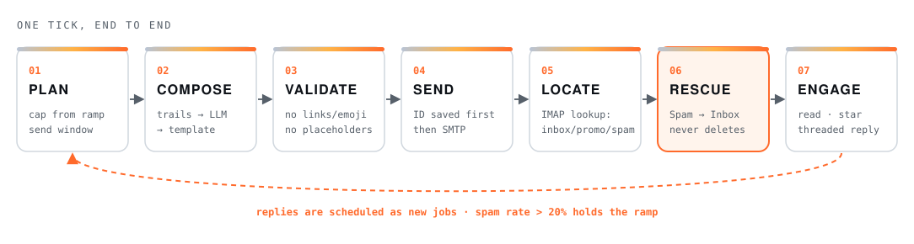
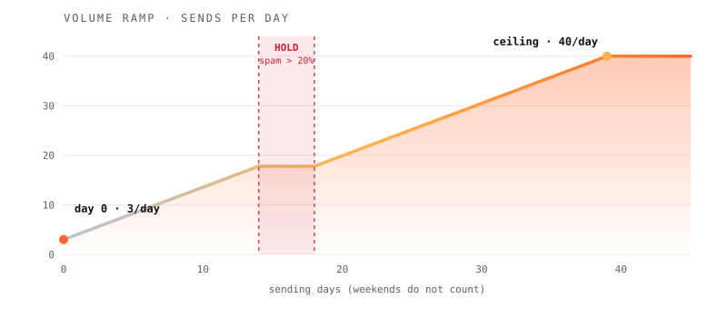
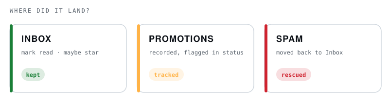
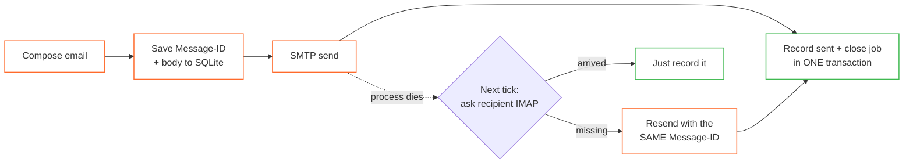

<h1 align="center">🔥 emberpost</h1>

<p align="center"><strong>Cold domain. Warm inbox. No guesswork.</strong></p>

<p align="center">
  <picture>
    <source media="(prefers-color-scheme: dark)" srcset="docs/assets/banner-dark.svg">
    
  </picture>
</p>

<p align="center">
Warms a new Google Workspace mailbox by running <strong>real, threaded business conversations</strong> with Gmail accounts you own. It ramps volume on a schedule, writes every email with an LLM, <strong>pulls mail out of Spam</strong>, and marks it read, starred and important. State lives in SQLite. A crash never double-sends.
</p>

<p align="center"><em>Send like a human. Recover like a machine.</em></p>

<p align="center">
  <a href="https://github.com/shubhamkatta/emberpost/actions/workflows/ci.yml"></a>
  <a href="LICENSE"></a>
  
  
  
  
  <a href="https://github.com/shubhamkatta/emberpost/stargazers"></a>
  <a href="https://github.com/shubhamkatta/emberpost/pulls"></a>
</p>

<details>
<summary><strong>📖 Contents</strong></summary>

- [Why emberpost](#why-emberpost)
- [How a tick works](#how-a-tick-works)
- [Features](#features)
- [The ramp](#the-ramp)
- [Placement and rescue](#placement-and-rescue)
- [Crash-safe sending](#crash-safe-sending)
- [Pre-generated conversations (trails)](#pre-generated-conversations-trails)
- [Quickstart](#quickstart)
- [Commands](#commands)
- [Monitoring and alerts](#monitoring-and-alerts)
- [Config validation](#config-validation)
- [Deploying](#deploying)
- [Limits you should know](#limits-you-should-know)
- [Responsible use](#responsible-use)
- [Contributing](#contributing)
- [License](#license)

</details>

---

## Why emberpost

A brand-new sending domain has no reputation. Send 200 cold emails on day one and Gmail files you under Spam. Hosted warmup tools cost a monthly fee, hand your passwords to a third party, and send the same canned text to every customer.

**emberpost is the self-hosted alternative.** You run it, you own the accounts, and nothing leaves your machine except SMTP and IMAP traffic and the LLM call.

- **Real conversations.** 2 to 5 messages per thread, correct `In-Reply-To` and `References` headers, quoted text, `Re:` subjects, human-length delays.
- **Verified placement.** Every message is found in the recipient mailbox. Spam gets moved to Inbox. You see the spam rate, not a vanity "emails sent" counter.
- **Self-throttling.** The ramp holds automatically while spam placement is above your threshold.
- **Boring to operate.** One process, one SQLite file, one config file. Restart whenever you want.

## How a tick works

<p align="center">
  <picture>
    <source media="(prefers-color-scheme: dark)" srcset="docs/assets/pipeline-dark.svg">
    
  </picture>
</p>

| Stage | What happens |
|---|---|
| **Plan** | Today's cap comes from the ramp. Threads are scheduled inside your send window, on weekdays by default. |
| **Compose** | Takes the next pre-written conversation from the trails file, else asks the LLM, else uses a template. |
| **Validate** | Rejects placeholders, links, emojis and meta text. Compares against recent mail and regenerates repeats. |
| **Send** | Saves the Message-ID to the database **before** SMTP is touched. |
| **Locate** | Finds the message in the recipient mailbox over IMAP: Inbox, Promotions or Spam. |
| **Rescue** | Moves Spam back to Inbox with copy-then-delete, so the only copy is never lost. |
| **Engage** | Marks received mail read, sometimes stars it, marks it Important, and schedules the reply. |

## Features

### Conversation engine
- **Two-way threads.** The primary opens threads to peers and peers open threads to the primary, with a configurable split.
- **Natural timing.** Reply delays of 8 minutes to 4 hours. `reply_rate` decides whether a thread continues, so some stop early, like real ones.
- **Claude-written content.** `llm.provider: cli` uses headless Claude Code and your login. `api` uses an Anthropic API key, the right choice on a server.
- **Template fallback.** After 3 hard LLM failures in a row, the LLM pauses for 30 minutes and an alert fires. `status` shows the LLM/template split.

### Deliverability control
- **Ramp** from `start_per_day` to `max_per_day` over `days_to_max` sending days. Weekends do not count.
- **Spam-rate gate.** The ramp pauses while the 3-day spam rate exceeds `hold_if_spam_rate_above`.
- **Spam rescue and engagement signals** on the receiving side, per peer.

### Operations
- **Alerts** to Slack, Discord or any JSON webhook. Throttled per kind, and the throttle survives restarts.
- **Dead-man's switch** heartbeat, pinged only after a tick succeeds.
- **`health` command** and a Docker `HEALTHCHECK` that fail when the loop stalls.
- **Verified online backups** of the database while it is running.

### Hardened by default
- **Config validation** reports every problem at once. A typo like `max_per_dya` gets "did you mean 'max_per_day'?".
- **Secrets stay in `.env`.** Webhook URLs and passwords are never read from `config.yaml` and never logged.
- **Docker image** runs unprivileged, read-only, all capabilities dropped. The systemd unit is sandboxed.
- **Runtime dependencies: 2** (`pyyaml`, `tzdata`). Everything else is the standard library.

## The ramp

<p align="center">
  <picture>
    <source media="(prefers-color-scheme: dark)" srcset="docs/assets/ramp-dark.svg">
    
  </picture>
</p>

Volume rises linearly from 3 to 40 sends a day across 35 sending days (defaults, all configurable). When spam placement crosses 20% (over at least 5 recent messages), the day counter stops until it recovers. The illustration shows a hold around day 14 to 18. Each hold delays full volume by exactly the days it lasted.

## Placement and rescue

<p align="center">
  <picture>
    <source media="(prefers-color-scheme: dark)" srcset="docs/assets/placement-dark.svg">
    
  </picture>
</p>

Placement is read from the recipient mailbox, not guessed. Promotions is detected from `X-GM-LABELS` and Gmail's `category:promotions` search.

## Crash-safe sending

**An email is composed once, saved, then sent.** If the process dies at any point, the next tick resolves it from the recipient mailbox instead of guessing.



- **No double sends.** A rare double delivery is collapsed by Gmail because the Message-ID is identical.
- **One process at a time.** `tick` and `run` take a lock on `warmup.db.lock`. A second `tick` (cron overlap) skips quietly. A second `run` exits with an error.
- **Login failures are handled, not guessed from error text.** A rejected login pauses that account, persisted in the database. Its jobs and attempt counts are kept, and the login is re-checked every `broken_retry_hours`. Paused accounts show as `BROKEN` in `status`.

## Pre-generated conversations (trails)

Write the conversations ahead of time and let the engine send them. You can read every email before it goes out.

```bash
python -m warmup generate --count 500    # keep at least 500 UNSENT emails in trails.jsonl
python -m warmup trails                  # stock, per-peer split, what has been used
python -m warmup trails --show 3         # read the next 3 conversations
```

- **A plain-text file.** `trails.jsonl` holds one whole conversation per line. It is append-only. Open it, delete a line you dislike, or add your own. Every line is validated on load. Bad lines are skipped with a warning and never sent.
- **`generate --count N` tops up to N unsent emails.** It is safe to re-run and resumes after interruption, because conversations are written one at a time. It uses the LLM only and refuses to write templates. It spreads threads evenly across peers, mixes who opens, asks the LLM for extra topics, and checks every email against the earlier ones.
- **State lives in the database** (`trail_state`), not the file: `reserved` when a day is planned, `active` after the first email, `done` after the last, `failed` if the opener could not be sent. The turn sent is recorded in the same transaction as the send.
- **When the file runs out,** `trails.fallback: live` writes on the fly. `stop` sends nothing new while started conversations still finish. You get an alert when stock drops below `trails.low_stock_alert`.
- Sign-offs use the first names configured at generation time. If you rename an account, regenerate or edit its lines.

## Quickstart

**1. Authenticate the primary domain first.** Warmup does not fix missing authentication.
- SPF, DKIM (enable in Workspace admin, then publish the key) and DMARC (`p=none` to start).

**2. Prepare every account** (primary and peers).
- Enable 2-Step Verification, create an App Password, enable IMAP. On Workspace, an admin may need to allow app passwords and IMAP.

**3. Install and configure.**

```bash
git clone https://github.com/shubhamkatta/emberpost && cd emberpost
pip install -r requirements.txt
cp config.example.yaml config.yaml    # accounts, personas, business description, ramp
cp .env.example .env                  # app passwords, ANTHROPIC_API_KEY, webhook URLs
```

**4. Verify, then run.**

```bash
python -m warmup validate    # config only, no network
python -m warmup check       # log in to SMTP and IMAP for every account
python -m warmup run         # loop forever. Or: `tick` from cron every 5 minutes
python -m warmup status      # ramp day, cap, placement rates
```

`peers.count` picks how many of the listed peer accounts are active.

**Try it with zero risk.** `--dry-run` runs the whole engine with no network and no secrets. It still writes to the configured database, so point `database:` at a throwaway file first.

## Commands

| Command | What it does |
|---|---|
| `validate` | Check the config only. |
| `check` | Log in to SMTP and IMAP for every account. |
| `tick` | Run one cycle (for cron). Skips quietly if another process holds the lock. |
| `run` | Loop forever. |
| `status` | Ramp day, cap, placement rates, content source, broken accounts. |
| `health` | Exit non-zero if the loop is stalled or failing. |
| `generate --count N` | Write conversations ahead of time until N unsent emails are in the trails file. |
| `trails [--show N]` | Trails stock, usage and a preview of the next conversations. |
| `backup --to DIR --keep N` | Verified online copy of the database. |
| `alert-test` | Send a test alert and heartbeat. |

Common flags: `-c config.yaml`, `--dry-run`, `-v`. Invoke as `python -m warmup <command>`, or as `emberpost <command>` after `pip install .`.

## Monitoring and alerts

Set these in `.env`. The URLs are secrets, so they are never read from `config.yaml`. Test with `python -m warmup alert-test`.

| Variable | Purpose |
|---|---|
| `ALERT_WEBHOOK_URL` | Slack or Discord incoming webhook, or any URL that accepts JSON. |
| `HEARTBEAT_URL` | Dead-man's switch (healthchecks.io, Better Stack, Uptime Kuma push). |

**You are alerted when** an account is disabled (and when it recovers), the ramp goes on hold for spam, a job is dropped after 4 failures, the LLM is paused, trail stock runs low, or 3 ticks in a row crash. Each kind is throttled (`alerts.min_interval_hours`, default 6) and the throttle survives restarts. A failed delivery is retried on the next event.

**The heartbeat pings only after a tick succeeds.** If the process dies, the machine sleeps or every tick fails, the pings stop and the monitor alerts you. Nothing running inside the process can report its own death. `python -m warmup health` exits non-zero if the loop stopped ticking or nothing has succeeded for hours. The Docker `HEALTHCHECK` uses it.

## Config validation

Every command validates `config.yaml` and reports **all** problems at once. Unknown keys are errors with a suggestion, because a typo would otherwise silently use the default. It also checks the timezone, send window, ranges and types, `peers.count` against the accounts listed, duplicate emails or password variables, missing secrets, and port 465.

Warnings, not errors, cover fewer than 3 peers, more than 50 sends a day, a ramp under 14 days, the LLM being off, and no alert webhook set.

## Deploying

The `claude` CLI login does not exist on a server or in a container. Set `llm.provider: api` and `ANTHROPIC_API_KEY` for either route. Before going live, run `validate`, `check` and `alert-test`.

### Docker

```bash
cp config.example.yaml config.yaml    # set database: /data/warmup.db and llm.provider: api
cp .env.example .env
docker compose up -d --build
docker compose logs -f
docker compose exec emberpost python -m warmup status -c /config/config.yaml
```

Runs as an unprivileged user with a read-only filesystem and all capabilities dropped. The database is on the `emberpost-data` volume. The image's `HEALTHCHECK` runs `warmup health`, which fails if the loop stopped ticking (30 min) or no tick has succeeded for 3 hours.

### systemd (VPS)

```bash
sudo useradd --system --home /opt/emberpost --shell /usr/sbin/nologin emberpost
sudo mkdir -p /opt/emberpost /etc/emberpost
sudo cp -r warmup requirements.txt /opt/emberpost/
sudo python3 -m venv /opt/emberpost/venv && sudo /opt/emberpost/venv/bin/pip install -r /opt/emberpost/requirements.txt
sudo cp config.yaml /etc/emberpost/config.yaml      # set database: /var/lib/emberpost/warmup.db
sudo cp .env /etc/emberpost/env                     # KEY=value lines, used as the unit's EnvironmentFile
sudo chown root:emberpost /etc/emberpost/* && sudo chmod 640 /etc/emberpost/*
sudo cp deploy/emberpost*.service deploy/emberpost-backup.timer /etc/systemd/system/
sudo systemctl daemon-reload && sudo systemctl enable --now emberpost emberpost-backup.timer
journalctl -u emberpost -f
```

The unit restarts on failure and is sandboxed (`ProtectSystem=strict`, only `/var/lib/emberpost` writable). Logs go to journald, which handles rotation.

### Operations

- **Backups.** `python -m warmup backup --to DIR --keep 14` takes a verified online copy, safe while `run` is going. The systemd timer does this daily into `/var/lib/emberpost/backups`. Those sit on the same disk, so copy them off the machine too.
- **Restoring.** Stop the service, replace `warmup.db` with a backup, start it. In-flight sends are reconciled on the next tick.
- **Stopping.** SIGTERM or `docker stop` is safe even mid-send.
- **CI.** `.github/workflows/ci.yml` runs lint and tests on Python 3.10 to 3.13, then builds the image and validates the example config inside it. Dependabot proposes updates weekly.
- **Development.** `pip install -r requirements.txt -r requirements-dev.txt`, then `pytest` and `ruff check .`.

### Tests

`pytest` runs 66 tests, no network, no real accounts.

| Suite | Covers |
|---|---|
| `test_sim` | A simulated 40-day run. |
| `test_robust` | Crash recovery, locking, broken accounts, content validation. |
| `test_imap` | The Gmail transport against a fake Gmail. |
| `test_trails` | Generation, the file format, how the engine consumes it. |
| `test_config` | Config validation and alerting. |
| `test_ops` | Health and backup. |

## Limits you should know

- **Credentials are app passwords** over SMTP and IMAP. OAuth is cleaner and the next step if Google restricts app passwords for your organisation.
- **A tight pool of Gmail accounts talking only to your domain is a pattern Google can detect.** More peers, different personas and moderate volume look less uniform. 5 to 10 peers is a good range. Keep `max_per_day` modest (30 to 50).
- **Promotions-tab placement is recorded but not auto-fixed.**
- **Warmup is not a substitute for authentication or list hygiene.** It cannot rescue a domain with broken SPF, DKIM or DMARC, or one that sends unwanted mail.

## Responsible use

emberpost is for warming mailboxes you own, using accounts you own, to send mail people asked for. Do not use it to prepare a domain for spam or bulk unsolicited mail. Follow Google's terms of service and your local email laws. You are responsible for how you use it.

## Contributing

Issues and PRs are welcome. Read [CONTRIBUTING.md](CONTRIBUTING.md) first and follow the [Code of Conduct](CODE_OF_CONDUCT.md). Run `pytest` and `ruff check .` before opening a PR. Report vulnerabilities privately, as described in [SECURITY.md](SECURITY.md).

## License

[MIT](LICENSE)
